# Biblioteca de símbolos: cartografia geológica (Bibl_Geologia_SGB_2019)

> Conversão automática de `Bibl_Geologia_SGB_2019.pdf` para Markdown, com os desenhos recortados do próprio PDF. Edição 2019. Gerado por `scripts/pdf_para_markdown.py`.
> Serviço Geológico do Brasil – CPRM · Diretoria de Geologia e Recursos Minerais · Departamento de Geologia · Divisão de Geologia Básica.

## Convenções geológicas e geofísicas para representação em mapas geológicos

| SÍMBOLO | SYMBOL SELECTOR (size) | TAMANHO (mm) | COR | NOMENCLATURA | BIBLIOTECA |
| --- | --- | --- | --- | --- | --- |
| 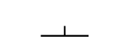 | 17,01 | 6 | PRETO 100% | Acamadamento | Bibl_Geologia_SGB_2019 |
| 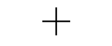 | 17,01 | 6 | PRETO 100% | Acamadamento horizontal | Bibl_Geologia_SGB_2019 |
| 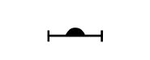 | 17,01 | 6 | PRETO 100% | Acamadamento ígneo | Bibl_Geologia_SGB_2019 |
|  | 14,17 | 5 | PRETO 100% | Acamadamento ígneo horizontal | Bibl_Geologia_SGB_2019 |
| 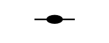 | 17,01 | 6 | PRETO 100% | Acamadamento ígneo vertical | Bibl_Geologia_SGB_2019 |
| 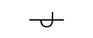 | 17,01 | 6 | PRETO 100% | Acamadamento invertido | Bibl_Geologia_SGB_2019 |
| 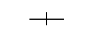 | 17,01 | 6 | PRETO 100% | Acamadamento vertical | Bibl_Geologia_SGB_2019 |
| 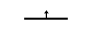 | 22,68 | 8 | PRETO 100% | Acamadamento vulcanoclástico | Bibl_Geologia_SGB_2019 |
| 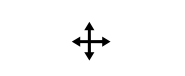 | 18 | 6,35 | PRETO 100% | Acamadamento vulcanoclástico horizontal | Bibl_Geologia_SGB_2019 |
| 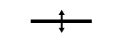 | 16 | 5,64 | PRETO 100% | Acamadamento vulcanoclástico vertical | Bibl_Geologia_SGB_2019 |
| 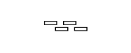 | 17,01 | 6 | PRETO 100% | Acumulação de cristais | Bibl_Geologia_SGB_2019 |
| 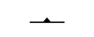 | 17,01 | 6 | PRETO 100% | Bandamento gnáissico | Bibl_Geologia_SGB_2019 |
| 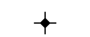 | 17,01 | 6 | PRETO 100% | Bandamento gnáissico horizontal | Bibl_Geologia_SGB_2019 |
| 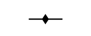 | 17,01 | 6 | PRETO 100% | Bandamento gnáissico vertical | Bibl_Geologia_SGB_2019 |
| 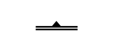 | 17,01 | 6 | PRETO 100% | Bandamento milonítico | Bibl_Geologia_SGB_2019 |
| 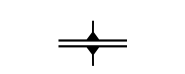 | 17,01 | 6 | PRETO 100% | Bandamento milonítico horizontal | Bibl_Geologia_SGB_2019 |
| 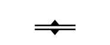 | 17,01 | 6 | PRETO 100% | Bandamento milonítico vertical | Bibl_Geologia_SGB_2019 |
| 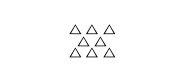 | 14,17 | 5 | PRETO 100% | Brecha de falha | Bibl_Geologia_SGB_2019 |
|  | 14,17 | 5 | PRETO 100% | Brecha hidrotermal | Bibl_Geologia_SGB_2019 |
| 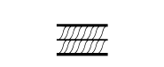 | 17,01 | 6 | PRETO 100% | Cavalgamento tipo duplex | Bibl_Geologia_SGB_2019 |
| 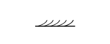 | 17,01 | 6 | PRETO 100% | Cavalgamento tipo leques imbricados | Bibl_Geologia_SGB_2019 |
| 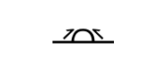 | 17,01 | 6 | PRETO 100% | Cavalgamento tipo pilha antiformal | Bibl_Geologia_SGB_2019 |
| 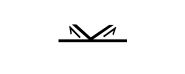 | 17,01 | 6 | PRETO 100% | Cavalgamentos divergentes tipo pop up | Bibl_Geologia_SGB_2019 |
| 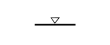 | 17,01 | 6 | PRETO 100% | Cavalgamentos tipo zona triangular | Bibl_Geologia_SGB_2019 |
| 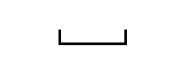 | 17,01 | 6 | PRETO 100% | Clivagem | Bibl_Geologia_SGB_2019 |
| 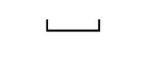 | 17,01 | 6 | PRETO 100% | Clivagem ardosiana | Bibl_Geologia_SGB_2019 |
|  | 14,17 | 5 | PRETO 100% | Clivagem ardosiana horizontal | Bibl_Geologia_SGB_2019 |
| 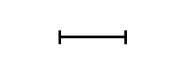 | 17,01 | 6 | PRETO 100% | Clivagem ardosiana vertical | Bibl_Geologia_SGB_2019 |
| 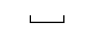 | 17,01 | 6 | PRETO 100% | Clivagem de crenulação | Bibl_Geologia_SGB_2019 |
|  | 14,17 | 5 | PRETO 100% | Clivagem de crenulação horizontal | Bibl_Geologia_SGB_2019 |
| 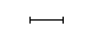 | 17,01 | 6 | PRETO 100% | Clivagem de crenulação vertical | Bibl_Geologia_SGB_2019 |
|  | 17,01 | 6 | PRETO 100% | Clivagem de fratura | Bibl_Geologia_SGB_2019 |
| 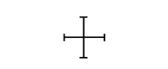 | 14,17 | 5 | PRETO 100% | Clivagem de fratura horizontal | Bibl_Geologia_SGB_2019 |
| 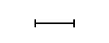 | 17,01 | 6 | PRETO 100% | Clivagem de fratura vertical | Bibl_Geologia_SGB_2019 |
| 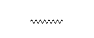 | 17,01 | 6 | PRETO 100% | Clivagem de solução por pressão | Bibl_Geologia_SGB_2019 |
| 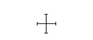 | 14,17 | 5 | PRETO 100% | Clivagem horizontal | Bibl_Geologia_SGB_2019 |
| 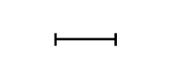 | 17,01 | 6 | PRETO 100% | Clivagem vertical | Bibl_Geologia_SGB_2019 |
|  | 11,34 | 4 | PRETO 100% | Corpos intrusivos fora de escala: kimberlitos, carbonatitos | Bibl_Geologia_SGB_2019 |
|  | 8,5 | 3 | PRETO 100% | Depósito mineral | Bibl_Geologia_SGB_2019 |
| 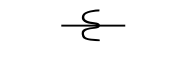 | 17,01 | 6 | PRETO 100% | Dobra horizontal | Bibl_Geologia_SGB_2019 |
| 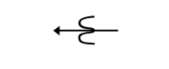 | 17,01 | 6 | PRETO 100% | Dobra aberta (120° a 70°) | Bibl_Geologia_SGB_2019 |
| 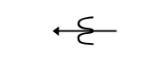 | 17,01 | 6 | PRETO 100% | Dobra apertada (30° a 0°) | Bibl_Geologia_SGB_2019 |
| 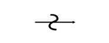 | 17,01 | 6 | PRETO 100% | Dobra assimétrica | Bibl_Geologia_SGB_2019 |
| 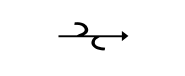 | 17,01 | 6 | PRETO 100% | Dobra de arrasto | Bibl_Geologia_SGB_2019 |
| 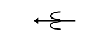 | 17,01 | 6 | PRETO 100% | Dobra desarmônica | Bibl_Geologia_SGB_2019 |
| 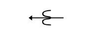 | 17,01 | 6 | PRETO 100% | Dobra em leque | Bibl_Geologia_SGB_2019 |
|  | 17,01 | 6 | PRETO 100% | Dobra fechada (70° a 30°) | Bibl_Geologia_SGB_2019 |
| 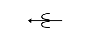 | 17,01 | 6 | PRETO 100% | Dobra inclinada | Bibl_Geologia_SGB_2019 |
| 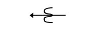 | 17,01 | 6 | PRETO 100% | Dobra intrafolial | Bibl_Geologia_SGB_2019 |
| 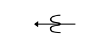 | 17,01 | 6 | PRETO 100% | Dobra isoclinal (0°) | Bibl_Geologia_SGB_2019 |
| 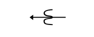 | 17,01 | 6 | PRETO 100% | Dobra normal | Bibl_Geologia_SGB_2019 |
| 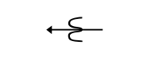 | 17,01 | 6 | PRETO 100% | Dobra paralela | Bibl_Geologia_SGB_2019 |
| 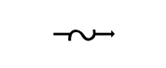 | 17,01 | 6 | PRETO 100% | Dobra parasítica tipo Z | Bibl_Geologia_SGB_2019 |
| 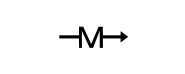 | 17,01 | 6 | PRETO 100% | Dobra parasítica tipo M | Bibl_Geologia_SGB_2019 |
| 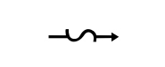 | 19,84 | 7 | PRETO 100% | Dobra parasítica tipo S | Bibl_Geologia_SGB_2019 |
|  | 17,01 | 6 | PRETO 100% | Dobra ptigmática | Bibl_Geologia_SGB_2019 |
| 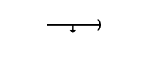 | 17,01 | 6 | PRETO 100% | Dobra reclinada | Bibl_Geologia_SGB_2019 |
| 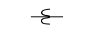 | 17,01 | 6 | PRETO 100% | Dobra recumbente | Bibl_Geologia_SGB_2019 |
|  | 17,01 | 6 | PRETO 100% | Dobra sem raiz | Bibl_Geologia_SGB_2019 |
| 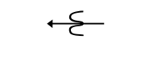 | 17,01 | 6 | PRETO 100% | Dobra similar | Bibl_Geologia_SGB_2019 |
|  | 17,01 | 6 | PRETO 100% | Dobra simétrica | Bibl_Geologia_SGB_2019 |
|  | 17,01 | 6 | PRETO 100% | Dobra suave (ângulo interlimbos: 180° a 120°) | Bibl_Geologia_SGB_2019 |
|  | 17,01 | 6 | PRETO 100% | Dobra tipo bainha | Bibl_Geologia_SGB_2019 |
|  | 17,01 | 6 | PRETO 100% | Dobra tipo caixa | Bibl_Geologia_SGB_2019 |
|  | 17,01 | 6 | PRETO 100% | Dobra tipo chevron | Bibl_Geologia_SGB_2019 |
|  | 17,01 | 6 | PRETO 100% | Dobra tipo kink | Bibl_Geologia_SGB_2019 |
|  | 17,01 | 6 | PRETO 100% | Dobra tipo rollover | Bibl_Geologia_SGB_2019 |
|  | 17,01 | 6 | PRETO 100% | Dobra vertical | Bibl_Geologia_SGB_2019 |
|  | 17,01 | 6 | PRETO 100% | Eixo de boudins | Bibl_Geologia_SGB_2019 |
|  | 17,01 | 6 | PRETO 100% | Eixo de lápis | Bibl_Geologia_SGB_2019 |
|  | 17,01 | 6 | PRETO 100% | Eixo de mullions | Bibl_Geologia_SGB_2019 |
|  | 17,01 | 6 | PRETO 100% | Eixo de rods | Bibl_Geologia_SGB_2019 |
|  | 17,01 | 6 | PRETO 100% | Entelhamentos de cristais | Bibl_Geologia_SGB_2019 |
|  | 17,01 | 6 | PRETO 100% | Estrias de deslizamento flexural em dobras | Bibl_Geologia_SGB_2019 |
|  | 22,68 | 8 | PRETO 100% | Estrias de falha (slickenlines) | Bibl_Geologia_SGB_2019 |
|  | 17,01 | 6 | PRETO 100% | Estrias glaciais | Bibl_Geologia_SGB_2019 |
|  | 17,01 | 6 | PRETO 100% | Flor negativa | Bibl_Geologia_SGB_2019 |
|  | 17,01 | 6 | PRETO 100% | Flor positiva | Bibl_Geologia_SGB_2019 |
|  | 17,01 | 6 | PRETO 100% | Foliação | Bibl_Geologia_SGB_2019 |
|  | 17,01 | 6 | PRETO 100% | Foliação de borda de intrusão (ortognaissificação) | Bibl_Geologia_SGB_2019 |
|  | 17,01 | 6 | PRETO 100% | Foliação de transposição | Bibl_Geologia_SGB_2019 |
|  | 17,01 | 6 | PRETO 100% | Foliação de transposição horizontal | Bibl_Geologia_SGB_2019 |
|  | 17,01 | 6 | PRETO 100% | Foliação de transposição vertical | Bibl_Geologia_SGB_2019 |
|  | 17,01 | 6 | PRETO 100% | Foliação horizontal | Bibl_Geologia_SGB_2019 |
|  | 17,01 | 6 | PRETO 100% | Foliação milonítica | Bibl_Geologia_SGB_2019 |
|  | 17,01 | 6 | PRETO 100% | Foliação milonítica horizontal | Bibl_Geologia_SGB_2019 |
|  | 17,01 | 6 | PRETO 100% | Foliação milonítica vertical | Bibl_Geologia_SGB_2019 |
|  | 17,01 | 6 | PRETO 100% | Foliação tipo C | Bibl_Geologia_SGB_2019 |
|  | 17,01 | 6 | PRETO 100% | Foliação tipo C' | Bibl_Geologia_SGB_2019 |
|  | 17,01 | 6 | PRETO 100% | Foliação tipo S | Bibl_Geologia_SGB_2019 |
|  | 17,01 | 6 | PRETO 100% | Foliação vertical | Bibl_Geologia_SGB_2019 |
|  | 17,01 | 6 | PRETO 100% | Fratura | Bibl_Geologia_SGB_2019 |
|  | 17,01 | 6 | PRETO 100% | Fratura de cisalhamento P | Bibl_Geologia_SGB_2019 |
|  | 17,01 | 6 | PRETO 100% | Fratura de cisalhamento R (Riedel) | Bibl_Geologia_SGB_2019 |
|  | 17,01 | 6 | PRETO 100% | Fratura de cisalhamento R' (anti-Riedel) | Bibl_Geologia_SGB_2019 |
|  | 17,01 | 6 | PRETO 100% | Fratura de cisalhamento X | Bibl_Geologia_SGB_2019 |
|  | 17,01 | 6 | PRETO 100% | Fratura de cisalhamento Y | Bibl_Geologia_SGB_2019 |
|  | 14,17 | 5 | PRETO 100% | Fratura horizontal | Bibl_Geologia_SGB_2019 |
|  | 22,68 | 8 | PRETO 100% | Fratura vertical | Bibl_Geologia_SGB_2019 |
|  | 19,84 | 7 | PRETO 100% | Garimpo em atividade | Bibl_Geologia_SGB_2019 |
|  | 19,84 | 7 | PRETO 100% | Garimpo paralisado | Bibl_Geologia_SGB_2019 |
|  | 17,01 | 6 | PRETO 100% | Gouge de falha | Bibl_Geologia_SGB_2019 |
|  | 17,01 | 6 | PRETO 100% | Junta | Bibl_Geologia_SGB_2019 |
|  | 17,01 | 6 | PRETO 100% | Junta com superfície plumosa | Bibl_Geologia_SGB_2019 |
|  | 17,01 | 6 | PRETO 100% | Junta de alívio de carga | Bibl_Geologia_SGB_2019 |
|  | 17,01 | 6 | PRETO 100% | Junta de cisalhamento | Bibl_Geologia_SGB_2019 |
|  | 17,01 | 6 | PRETO 100% | Junta estilolítica | Bibl_Geologia_SGB_2019 |
|  | 17,01 | 6 | PRETO 100% | Junta extensional | Bibl_Geologia_SGB_2019 |
|  | 14,17 | 5 | PRETO 100% | Junta extensional horizontal | Bibl_Geologia_SGB_2019 |
|  | 14,17 | 5 | PRETO 100% | Junta extensional vertical | Bibl_Geologia_SGB_2019 |
|  | 14,17 | 5 | PRETO 100% | Junta horizontal | Bibl_Geologia_SGB_2019 |
|  | 17,01 | 6 | PRETO 100% | Junta híbrida | Bibl_Geologia_SGB_2019 |
|  | 22,68 | 8 | PRETO 100% | Junta vertical | Bibl_Geologia_SGB_2019 |
|  | 17,01 | 6 | PRETO 100% | Juntas colunares | Bibl_Geologia_SGB_2019 |
|  | 17,01 | 6 | PRETO 100% | Juntas de resfriamento | Bibl_Geologia_SGB_2019 |
|  | 17,01 | 6 | PRETO 100% | Lineação B (eixo de dobra) | Bibl_Geologia_SGB_2019 |
|  | 17,01 | 6 | PRETO 100% | Lineação B (eixo de dobra) horizontal | Bibl_Geologia_SGB_2019 |
|  | 11,34 | 4 | PRETO 100% | Lineação B (eixo de dobra) vertical | Bibl_Geologia_SGB_2019 |
|  | 17,01 | 6 | PRETO 100% | Lineação de estiramento | Bibl_Geologia_SGB_2019 |
|  | 17,01 | 6 | PRETO 100% | Lineação de estiramento com movimento dextral indicado | Bibl_Geologia_SGB_2019 |
|  | 17,01 | 6 | PRETO 100% | Lineação de estiramento horizontal | Bibl_Geologia_SGB_2019 |
|  | 17,01 | 6 | PRETO 100% | Lineação de estiramento horizontal com movimento sinistral indicado | Bibl_Geologia_SGB_2019 |
|  | 11,34 | 4 | PRETO 100% | Lineação de estiramento vertical | Bibl_Geologia_SGB_2019 |
|  | 17,01 | 6 | PRETO 100% | Lineação de fluxo magnético (minerais e enclaves) | Bibl_Geologia_SGB_2019 |
|  | 17,01 | 6 | PRETO 100% | Lineação de interseção entre acamadamento e clivagem | Bibl_Geologia_SGB_2019 |
|  | 17,01 | 6 | PRETO 100% | Lineação de interseção entre foliações ou clivagens | Bibl_Geologia_SGB_2019 |
|  | 17,01 | 6 | PRETO 100% | Lineação mineral | Bibl_Geologia_SGB_2019 |
|  | 17,01 | 6 | PRETO 100% | Lineação mineral horizontal | Bibl_Geologia_SGB_2019 |
|  | 8,50 | 3 | PRETO 100% | Lineação mineral vertical | Bibl_Geologia_SGB_2019 |
|  | 17,01 | 6 | PRETO 100% | Lineação de minerais alongados em veio | Bibl_Geologia_SGB_2019 |
|  | 19,84 | 7 | PRETO 100% | Mina em atividade | Bibl_Geologia_SGB_2019 |
|  | 19,84 | 7 | PRETO 100% | Mina paralisada | Bibl_Geologia_SGB_2019 |
|  | 8,5 | 3 | PRETO 100% | Ocorrência mineral | Bibl_Geologia_SGB_2019 |
|  | 17,01 | 6 | PRETO 100% | Peixes de mica (mica fish) | Bibl_Geologia_SGB_2019 |
|  | 17,01 | 6 | PRETO 100% | Pillow lava | Bibl_Geologia_SGB_2019 |
|  | 17,01 | 6 | PRETO 100% | Plano (superfície) axial de dobra | Bibl_Geologia_SGB_2019 |
|  | 17,01 | 6 | PRETO 100% | Porfiroblastos/porfiroclastos assimétricos tipo delta | Bibl_Geologia_SGB_2019 |
|  | 14,17 | 5 | PRETO 100% | Porfiroblastos/porfiroclastos assimétricos tipo sigma | Bibl_Geologia_SGB_2019 |
|  | 14,17 | 5 | PRETO 100% | Porfiroclastos simétricos | Bibl_Geologia_SGB_2019 |
|  | 14,17 | 5 | PRETO 100% | Redobramento tipo bumerangue | Bibl_Geologia_SGB_2019 |
|  | 11,34 | 4 | PRETO 100% | Redobramento tipo domos e bacias | Bibl_Geologia_SGB_2019 |
|  | 14,17 | 5 | PRETO 100% | Redobramento tipo laço (coaxial) | Bibl_Geologia_SGB_2019 |
|  | 14,17 | 5 | PRETO 100% | Sentido de topo estratigráfico | Bibl_Geologia_SGB_2019 |
|  | 17,01 | 6 | PRETO 100% | Sentido de transporte tectônico | Bibl_Geologia_SGB_2019 |
|  | 14,17 | 5 | PRETO 100% | Seta 1 | Bibl_Geologia_SGB_2019 |
|  | 14,17 | 5 | PRETO 100% | Seta 2 | Bibl_Geologia_SGB_2019 |
|  | 14,17 | 5 | PRETO 100% | Seta 3 | Bibl_Geologia_SGB_2019 |
|  | 14,17 | 5 | PRETO 100% | Seta 4 | Bibl_Geologia_SGB_2019 |
|  | 14,17 | 5 | PRETO 100% | Seta 5 | Bibl_Geologia_SGB_2019 |
|  | 17,01 | 6 | PRETO 100% | Seta 6 | Bibl_Geologia_SGB_2019 |
|  | 17,01 | 6 | PRETO 100% | Seta 7 | Bibl_Geologia_SGB_2019 |
|  | 14,17 | 5 | PRETO 100% | Seta 8 | Bibl_Geologia_SGB_2019 |
|  | 14,17 | 5 | PRETO 100% | Símbolo Anticlinal | Bibl_Geologia_SGB_2019 |
|  | 14,17 | 5 | PRETO 100% | Símbolo Sinclinal | Bibl_Geologia_SGB_2019 |
|  | 14,17 | 5 | PRETO 100% | Stockwork | Bibl_Geologia_SGB_2019 |
|  | 17,01 | 6 | PRETO 100% | Superfície de fluxo magnético | Bibl_Geologia_SGB_2019 |
|  | 17,01 | 6 | PRETO 100% | Superfície de fluxo magnético horizontal | Bibl_Geologia_SGB_2019 |
|  | 17,01 | 6 | PRETO 100% | Superfície de fluxo magnético vertical | Bibl_Geologia_SGB_2019 |
|  | 17,01 | 6 | PRETO 100% | Tectonito L | Bibl_Geologia_SGB_2019 |
|  | 17,01 | 6 | PRETO 100% | Tectonito LS | Bibl_Geologia_SGB_2019 |
|  | 17,01 | 6 | PRETO 100% | Tectonito S | Bibl_Geologia_SGB_2019 |
|  | 17,01 | 6 | PRETO 100% | Veio | Bibl_Geologia_SGB_2019 |
|  | 17,01 | 6 | PRETO 100% | Veio de cisalhamento | Bibl_Geologia_SGB_2019 |
|  | 17,01 | 6 | PRETO 100% | Veio extensional | Bibl_Geologia_SGB_2019 |
|  | 17,01 | 6 | PRETO 100% | Veio híbrido dextral | Bibl_Geologia_SGB_2019 |
|  | 17,01 | 6 | PRETO 100% | Veio híbrido sinistral | Bibl_Geologia_SGB_2019 |
|  | 17,01 | 6 | PRETO 100% | Veio irregular | Bibl_Geologia_SGB_2019 |
|  | 17,01 | 6 | PRETO 100% | Veio laminado | Bibl_Geologia_SGB_2019 |
|  | 19,84 | 7 | PRETO 100% | Xistosidade | Bibl_Geologia_SGB_2019 |
|  | 14,17 | 5 | PRETO 100% | Xistosidade horizontal | Bibl_Geologia_SGB_2019 |
|  | 17,01 | 6 | PRETO 100% | Xistosidade vertical | Bibl_Geologia_SGB_2019 |
|  | 19,84 | 7 | PRETO 100% | Zona de veios escalonados (tension gashes) | Bibl_Geologia_SGB_2019 |
|  | 11,34 | 4 | PRETO 100% | Zona de veios multidirecionais | Bibl_Geologia_SGB_2019 |
|  | 19,84 | 7 | PRETO 100% | Zona extensional tipo pull apart | Bibl_Geologia_SGB_2019 |

### Feições lineares

| FEIÇÕES LINEARES | NOMENCLATURA | TRAÇO (mm) | COR | BIBLIOTECA |
| --- | --- | --- | --- | --- |
|  | Anticlinal ou antiforme invertido | 0,25 | PRETO 100% | Bibl_Geologia_SGB_2019 |
|  | Anticlinal ou antiforme invertido com caimento indicado d | 0,25 | PRETO 100% | Bibl_Geologia_SGB_2019 |
|  | Anticlinal ou antiforme invertido com caimento indicado e | 0,25 | PRETO 100% | Bibl_Geologia_SGB_2019 |
|  | Anticlinal ou antiforme normal | 0,25 | PRETO 100% | Bibl_Geologia_SGB_2019 |
|  | Anticlinal ou antiforme normal com caimento indicado d | 0,25 | PRETO 100% | Bibl_Geologia_SGB_2019 |
|  | Anticlinal ou antiforme normal com caimento indicado e | 0,25 | PRETO 100% | Bibl_Estrutural_CPRM |
|  | Anticlinório | 0,20 | PRETO 100% | Bibl_Geologia_SGB_2019 |
|  | Arco de bacia | 0,25 | PRETO 100% | Bibl_Geologia_SGB_2019 |
|  | Bacia | 0,25 | PRETO 100% | Bibl_Geologia_SGB_2019 |
|  | Banda de cisalhamento | 0,25 | PRETO 100% | Bibl_Geologia_SGB_2019 |
|  | Banda de cisalhamento compressional | 0,25 | PRETO 100% | Bibl_Geologia_SGB_2019 |
|  | Banda de cisalhamento extensional | 0,25 | PRETO 100% | Bibl_Geologia_SGB_2019 |
|  | Banda de cisalhamento transcorrente dextral | 0,25 | PRETO 100% | Bibl_Geologia_SGB_2019 |
|  | Banda de cisalhamento transcorrente sinistral | 0,25 | PRETO 100% | Bibl_Geologia_SGB_2019 |
|  | Braquianticlinal invertido | 0,25 | PRETO 100% | Bibl_Geologia_SGB_2019 |
|  | Braquianticlinal ou braquiantiforme | 0,25 | PRETO 100% | Bibl_Geologia_SGB_2019 |
|  | Braquissinclinal ou braquissinforme | 0,25 | PRETO 100% | Bibl_Geologia_SGB_2019 |
|  | Braquissinclinal invertido | 0,25 | PRETO 100% | Bibl_Geologia_SGB_2019 |
|  | Calha de bacia | 0,20 | PRETO 100% | Bibl_Geologia_SGB_2019 |
|  | Contato | 0,20 | PRETO 100% | Bibl_Estrutural_CPRM |
|  | Contato aproximado | 0,20 | PRETO 100% | Bibl_Geologia_SGB_2019 |
|  | Contato encoberto | 0,20 | PRETO 100% | Bibl_Geologia_SGB_2019 |
|  | Contato transicional | 0,20 | PRETO 100% | Bibl_Geologia_SGB_2019 |
|  | Dique | 0,25 | PRETO 100% | Bibl_Geologia_SGB_2019 |
|  | Dique com indicação de mergulho | 0,25 | PRETO 100% | Bibl_Geologia_SGB_2019 |
|  | Dique magnético (com estimativa da profundidade em metros) | 0,50 | C 20% M47% Y54% | Bibl_Geologia_SGB_2019 |
|  | Dique vertical | 0,25 | PRETO 100% | Bibl_Geologia_SGB_2019 |
|  | Disconformidade | - | PRETO 100% | Bibl_Geologia_SGB_2019 |
|  | Domo | 0,20 | PRETO 100% | Bibl_Geologia_SGB_2019 |
|  | Estrutura de impacto | 0,30 | PRETO 100% | Bibl_Geologia_SGB_2019 |
|  | Falha contracional | 0,30 | PRETO 100% | Bibl_Geologia_SGB_2019 |
|  | Falha contracional dextral | 0,30 | PRETO 100% | Bibl_Geologia_SGB_2019 |
|  | Falha contracional encoberta | 0,30 | PRETO 100% | Bibl_Geologia_SGB_2019 |
|  | Falha contracional sinistral | 0,30 | PRETO 100% | Bibl_Geologia_SGB_2019 |
|  | Falha encoberta | 0,30 | PRETO 100% | Bibl_Geologia_SGB_2019 |
|  | Falha extensional | 0,30 | PRETO 100% | Bibl_Geologia_SGB_2019 |
|  | Falha extensional aproximada | 0,25 | PRETO 100% | Bibl_Geologia_SGB_2019 |
|  | Falha extensional dextral | 0,30 | PRETO 100% | Bibl_Geologia_SGB_2019 |
|  | Falha extensional encoberta | 0,25 | PRETO 100% | Bibl_Geologia_SGB_2019 |
|  | Falha extensional sinistral | 0,30 | PRETO 100% | Bibl_Estrutural_CPRM |
|  | Falha indiscriminada | 0,30 | PRETO 100% | Bibl_Geologia_SGB_2019 |
|  | Falha ou fratura aproximada | 0,30 | PRETO 100% | Bibl_Geologia_SGB_2019 |
|  | Falha transcorrente dextral | 0,30 | PRETO 100% | Bibl_Geologia_SGB_2019 |
|  | Falha transcorrente encoberta dextral | 0,30 | PRETO 100% | Bibl_Geologia_SGB_2019 |
|  | Falha transcorrente encoberta sinistral | 0,30 | PRETO 100% | Bibl_Geologia_SGB_2019 |
|  | Falha transcorrente sinistral | 0,30 | PRETO 100% | Bibl_Geologia_SGB_2019 |
|  | Falha transicional | 0,30 | PRETO 100% | Bibl_Geologia_SGB_2019 |
|  | Flexura antiformal | 0,25 | PRETO 100% | Bibl_Geologia_SGB_2019 |
|  | Flexura sinformal | 0,25 | PRETO 100% | Bibl_Geologia_SGB_2019 |
|  | Fratura | 0,30 | PRETO 100% | Bibl_Geologia_SGB_2019 |
|  | Gravimétrica | 0,80 | C 20% M47% Y54% | Bibl_Geologia_SGB_2019 |
|  | Isógrada | 0,25 | PRETO 100% | Bibl_Geologia_SGB_2019 |
|  | Lineamentos estruturais | 0,18 | PRETO 100% | Bibl_Geologia_SGB_2019 |
|  | Lineamentos magnetométrico ou gravimétrico | 0,50 | C 20% M47% Y54% | Bibl_Estrutural_CPRM |
|  | Magnetométrica | 0,80 | C 20% M47% Y54% | Bibl_Geologia_SGB_2019 |
|  | Sinclinal normal | 0,27 | PRETO 100% | Bibl_Geologia_SGB_2019 |
|  | Sinclinal ou sinforme invertido | 0,27 | PRETO 100% | Bibl_Geologia_SGB_2019 |
|  | Sinclinal ou sinforme invertido com caimento indicado d | 0,27 | PRETO 100% | Bibl_Geologia_SGB_2019 |
|  | Sinclinal ou sinforme invertido com caimento indicado e | 0,27 | PRETO 100% | Bibl_Geologia_SGB_2019 |
|  | Sinclinal ou sinforme normal com caimento indicado d | 0,27 | PRETO 100% | Bibl_Geologia_SGB_2019 |
|  | Sinclinal ou sinforme normal com caimento indicado e | 0,27 | PRETO 100% | Bibl_Geologia_SGB_2019 |
|  | Sinclinório | 0,20 | PRETO 100% | Bibl_Geologia_SGB_2019 |
|  | Zona de brecha | - | PRETO 100% | Bibl_Geologia_SGB_2019 |
|  | Zona de cisalhamento compressional | 0,30 | PRETO 100% | Bibl_Geologia_SGB_2019 |
|  | Zona de cisalhamento compressional aproximada | 0,30 | PRETO 100% | Bibl_Geologia_SGB_2019 |
|  | Zona de cisalhamento compressional dextral | 0,30 | PRETO 100% | Bibl_Geologia_SGB_2019 |
|  | Zona de cisalhamento compressional encoberta | - | PRETO 100% | Bibl_Geologia_SGB_2019 |
|  | Zona de cisalhamento compressional sinistral | 0,30 | PRETO 100% | Bibl_Geologia_SGB_2019 |
|  | Zona de cisalhamento extensional aproximada | - | PRETO 100% | Bibl_Geologia_SGB_2019 |
|  | Zona de cisalhamento extensional encoberta | - | PRETO 100% | Bibl_Geologia_SGB_2019 |
|  | Zona de cisalhamento | 0,30 | PRETO 100% | Bibl_Geologia_SGB_2019 |
|  | Zona de cisalhamento transcorrente dextral | 0,30 | PRETO 100% | Bibl_Geologia_SGB_2019 |
|  | Zona de cisalhamento transcorrente encoberta dextral | 0,30 | PRETO 100% | Bibl_Geologia_SGB_2019 |
|  | Zona de cisalhamento transcorrente encoberta sinistral | 0,30 | PRETO 100% | Bibl_Geologia_SGB_2019 |
|  | Zona de cisalhamento transcorrente sinistral | 0,30 | PRETO 100% | Bibl_Geologia_SGB_2019 |
|  | Zona de cisalhamento transtracional | 0,30 | PRETO 100% | Bibl_Geologia_SGB_2019 |
|  | Zona de cisalhamento transtracional dextral | 0,30 | PRETO 100% | Bibl_Geologia_SGB_2019 |
|  | Zona de cisalhamento transtracional sinistral | 0,30 | PRETO 100% | Bibl_Geologia_SGB_2019 |
|  | Zona de cisalhamento transtracional aproximada | 0,30 | PRETO 100% | Bibl_Geologia_SGB_2019 |
|  | Zona de falha | 0,18 | PRETO 100% | Bibl_Geologia_SGB_2019 |
|  | Zona milonítica | - | PRETO 100% | Bibl_Geologia_SGB_2019 |

### Feições planares

| FEIÇÕES PLANARES | NOMENCLATURA | TRAÇO (mm) | COR | BIBLIOTECA |
| --- | --- | --- | --- | --- |
|  | Feições Magnetométricas (com eventual estimativa de profundidade) | 0,40 | C 20% M47% Y54% | Bibl_Geologia_SGB_2019 |
|  | Feições Gravimétricas (com eventual estimativa de profundidade) | 0,40 | C 20% M47% Y54% | Bibl_Geologia_SGB_2019 |

ORIENTAÇÕES:

1) Inserir a profundidade em metros nas convenções geofísicas lineares e planares, conforme mostrado nessa tabela; nas lineares, os números deverão ficar acima da linha, e na planares, sobre a mesma;

2) Para caso de símbolos iguais em diferentes estruturas ou gerações de deformações, representar com cores distintas;

3) Escolher uma nomenclatura para as legendas dos mapas quando este vier acompanhado da conjunção "ou", como no exemplo a seguir:  
Ex. Nomenclatura da simbologia: Sinclinal ou sinforme invertido  
Nas convenções geológicas: Sinclinal invertido

4) Os Lineamentos estruturais são os mesmos que representam os fotolineamentos e/ou traços de superfície S.

## Simbologia de fósseis

| SÍMBOLO | SYMBOL SELECTOR (size) | TAMANHO (mm) | COR | NOMENCLATURA | BIBLIOTECA |
| --- | --- | --- | --- | --- | --- |
|  | 14,17 | 5 | PRETO 100% | Acritarcos | Bibl_Geologia_SGB_2019 |
|  | 11,34 | 4 | PRETO 100% | Algas | Bibl_Geologia_SGB_2019 |
|  | 12 | 4,23 | PRETO 100% | Amonoides | Bibl_Geologia_SGB_2019 |
|  | 15,59 | 5,5 | PRETO 100% | Anelídeos | Bibl_Geologia_SGB_2019 |
|  | 12 | 4,23 | PRETO 100% | Anfíbios | Bibl_Geologia_SGB_2019 |
|  | 11,34 | 4 | PRETO 100% | Angiospermas | Bibl_Geologia_SGB_2019 |
|  | 12 | 4,23 | PRETO 100% | Aracnídeo | Bibl_Geologia_SGB_2019 |
|  | 11,50 | 4,05 | PRETO 100% | Artropoda | Bibl_Geologia_SGB_2019 |
|  | 5 | 1,76 | PRETO 100% | Belemnoids | Bibl_Geologia_SGB_2019 |
|  | 6 | 2,11 | PRETO 100% | Braquiópodes | Bibl_Geologia_SGB_2019 |
|  | 14,17 | 5 | PRETO 100% | Briozoários | Bibl_Geologia_SGB_2019 |
|  | 12 | 4,23 | PRETO 100% | Cefalópodes | Bibl_Geologia_SGB_2019 |
|  | 11,34 | 4 | PRETO 100% | Cnidários | Bibl_Geologia_SGB_2019 |
|  | 11,34 | 4 | PRETO 100% | Conodontes | Bibl_Geologia_SGB_2019 |
|  | 9,92 | 3,5 | PRETO 100% | Coníferas | Bibl_Geologia_SGB_2019 |
|  | 14 | 4,93 | PRETO 100% | Coprólitos | Bibl_Geologia_SGB_2019 |
|  | 11,34 | 4 | PRETO 100% | Corais | Bibl_Geologia_SGB_2019 |
|  | 11,34 | 4 | PRETO 100% | Crinoides | Bibl_Geologia_SGB_2019 |
|  | 11,34 | 4 | PRETO 100% | Crustáceos | Bibl_Geologia_SGB_2019 |
|  | 7 | 2,46 | PRETO 100% | Diatomáceas | Bibl_Geologia_SGB_2019 |
|  | 14,17 | 5 | PRETO 100% | Dinoflagelados | Bibl_Geologia_SGB_2019 |
|  | 14,17 | 5 | PRETO 100% | Equinodermos | Bibl_Geologia_SGB_2019 |
|  | 14,17 | 5 | PRETO 100% | Equinoides | Bibl_Geologia_SGB_2019 |
|  | 12 | 4,23 | PRETO 100% | Esponjas | Bibl_Geologia_SGB_2019 |
|  | 9,07 | 3,20 | PRETO 100% | Espículas (poríferos) | Bibl_Geologia_SGB_2019 |
|  | 10 | 3,52 | PRETO 100% | Estromatólitos | Bibl_Geologia_SGB_2019 |
|  | 14,17 | 5 | PRETO 100% | Folhas | Bibl_Geologia_SGB_2019 |
|  | 11,34 | 4 | PRETO 100% | Foraminíferos | Bibl_Geologia_SGB_2019 |
|  | 11,34 | 4 | PRETO 100% | Foraminíferos Planctônicos | Bibl_Geologia_SGB_2019 |
|  | 11,34 | 4 | PRETO 100% | Foraminíferos bentônicos | Bibl_Geologia_SGB_2019 |
|  | 14,17 | 5 | PRETO 100% | Foraminíferos grandes ou fusulinídeos | Bibl_Geologia_SGB_2019 |
|  | 11,34 | 4 | PRETO 100% | Fungos | Bibl_Geologia_SGB_2019 |
|  | 14,17 | 5 | PRETO 100% | Gastrópodes | Bibl_Geologia_SGB_2019 |
|  | 4,82 | 1,70 | PRETO 100% | Graptólitos | Bibl_Geologia_SGB_2019 |
|  | 11 | 3,88 | PRETO 100% | Insetos | Bibl_Geologia_SGB_2019 |
|  | 9,92 | 3,50 | PRETO 100% | Invertebrados | Bibl_Geologia_SGB_2019 |
|  | 12 | 4,23 | PRETO 100% | Macrofósseis | Bibl_Geologia_SGB_2019 |
|  | 6 | 2,11 | PRETO 100% | Madeira fóssil | Bibl_Geologia_SGB_2019 |
|  | 9,92 | 3,5 | PRETO 100% | Mamíferos | Bibl_Geologia_SGB_2019 |
|  | 15,59 | 5,5 | PRETO 100% | Microfósseis | Bibl_Geologia_SGB_2019 |
|  | 10 | 3,52 | PRETO 100% | Moluscos | Bibl_Geologia_SGB_2019 |
|  | 8 | 2,82 | PRETO 100% | Nanofósseis calcário | Bibl_Geologia_SGB_2019 |
|  | 10 | 3,52 | PRETO 100% | Nautiloides | Bibl_Geologia_SGB_2019 |
|  | 7,0 | 2,46 | PRETO 100% | Ostracodes | Bibl_Geologia_SGB_2019 |
|  | 5 | 1,76 | PRETO 100% | Palinomorfos | Bibl_Geologia_SGB_2019 |
|  | 11,34 | 4 | PRETO 100% | Pegadas | Bibl_Geologia_SGB_2019 |
|  | 9 | 3,17 | PRETO 100% | Peixes | Bibl_Geologia_SGB_2019 |
|  | 9,92 | 3,5 | PRETO 100% | Pelecípodes (Bivalve) | Bibl_Geologia_SGB_2019 |
|  | 8 | 2,82 | PRETO 100% | Perfurações | Bibl_Geologia_SGB_2019 |
|  | 11 | 3,88 | PRETO 100% | Plantas | Bibl_Geologia_SGB_2019 |
|  | 11,34 | 4 | PRETO 100% | Pólen e/ou esporos | Bibl_Geologia_SGB_2019 |
|  | 11,34 | 4 | PRETO 100% | Quitinozoários | Bibl_Geologia_SGB_2019 |
|  | 14,17 | 5 | PRETO 100% | Radiolários | Bibl_Geologia_SGB_2019 |
|  | 12,76 | 4,5 | PRETO 100% | Raízes | Bibl_Geologia_SGB_2019 |
|  | 10 | 3,52 | PRETO 100% | Répteis | Bibl_Geologia_SGB_2019 |
|  | 10 | 3,52 | PRETO 100% | Samambaias | Bibl_Geologia_SGB_2019 |
|  | 10 | 3,52 | PRETO 100% | Silicoflagelados | Bibl_Geologia_SGB_2019 |
|  | 9 | 3,17 | PRETO 100% | Stromatoporoids | Bibl_Geologia_SGB_2019 |
|  | 6 | 2,11 | PRETO 100% | Traços fósseis | Bibl_Geologia_SGB_2019 |
|  | 9 | 3,17 | PRETO 100% | Trilobitas | Bibl_Geologia_SGB_2019 |
|  | 9,07 | 3,20 | PRETO 100% | Vertebrados | Bibl_Geologia_SGB_2019 |

## Simbologia de estruturas sedimentares

| SÍMBOLO | SYMBOL SELECTOR (size) | TAMANHO (mm) | COR | NOMENCLATURA | BIBLIOTECA |
| --- | --- | --- | --- | --- | --- |
|  | 8,53 | 3 | PRETO 100% | Bimodalidade | Bibl_Geologia_SGB_2019 |
|  | 5,67 | 2 | PRETO 100% | Birdseye | Bibl_Geologia_SGB_2019 |
|  | 12 | 4,23 | PRETO 100% | Brecha de colapso | Bibl_Geologia_SGB_2019 |
|  | 7 | 2,46 | PRETO 100% | Caliche | Bibl_Geologia_SGB_2019 |
|  | 12 | 4,23 | PRETO 100% | Concreção calcítica | Bibl_Geologia_SGB_2019 |
|  | 12 | 4,23 | PRETO 100% | Concreção dolomítica | Bibl_Geologia_SGB_2019 |
|  | 12 | 4,23 | PRETO 100% | Concreção ferro-magnesífera | Bibl_Geologia_SGB_2019 |
|  | 12 | 4,23 | PRETO 100% | Concreção fosfática | Bibl_Geologia_SGB_2019 |
|  | 12 | 4,23 | PRETO 100% | Concreção piritosa | Bibl_Geologia_SGB_2019 |
|  | 12 | 4,23 | PRETO 100% | Concreção silicosa | Bibl_Geologia_SGB_2019 |
|  | 11,34 | 4 | PRETO 100% | Cone-in-cone | Bibl_Geologia_SGB_2019 |
|  | 5,67 | 2 | PRETO 100% | Crosta (hardground) | Bibl_Geologia_SGB_2019 |
|  | 14 | 4,94 | PRETO 100% | Direção de paleocorrente | Bibl_Geologia_SGB_2019 |
|  | 7,09 | 2,5 | PRETO 100% | Dique clástico | Bibl_Geologia_SGB_2019 |
|  | 9,92 | 3,5 | PRETO 100% | Estilólitos | Bibl_Geologia_SGB_2019 |
|  | 5,67 | 2 | PRETO 100% | Estratificação cruzada acanalada | Bibl_Geologia_SGB_2019 |
|  | 7 | 2,46 | PRETO 100% | Estratificação cruzada de baixo ângulo | Bibl_Geologia_SGB_2019 |
|  | 7 | 2,46 | PRETO 100% | Estratificação cruzada espinha-de-peixe | Bibl_Geologia_SGB_2019 |
|  | 7 | 2,46 | PRETO 100% | Estratificação cruzada hummocky | Bibl_Geologia_SGB_2019 |
|  | 5,67 | 2 | PRETO 100% | Estratificação cruzada sigmoidal | Bibl_Geologia_SGB_2019 |
|  | 5,39 | 1,9 | PRETO 100% | Estratificação cruzada swaley | Bibl_Geologia_SGB_2019 |
|  | 7 | 2,46 | PRETO 100% | Estratificação cruzada tabular | Bibl_Geologia_SGB_2019 |
|  | 7 | 2,46 | PRETO 100% | Estratificação cruzada tangencial | Bibl_Geologia_SGB_2019 |
|  | 5,67 | 2 | PRETO 100% | Estratificação de maré | Bibl_Geologia_SGB_2019 |
|  | 6 | 2,11 | PRETO 100% | Estratificação plano-paralela | Bibl_Geologia_SGB_2019 |
|  | 7 | 2,46 | PRETO 100% | Estrutura convoluta | Bibl_Geologia_SGB_2019 |
|  | 5,67 | 2 | PRETO 100% | Estrutura de bola e almofada | Bibl_Geologia_SGB_2019 |
|  | 4 | 1,41 | PRETO 100% | Estrutura de corte e preenchimento | Bibl_Geologia_SGB_2019 |
|  | 7 | 2,46 | PRETO 100% | Estrutura de escorregamento | Bibl_Geologia_SGB_2019 |
|  | 7 | 2,46 | PRETO 100% | Estrutura em chama | Bibl_Geologia_SGB_2019 |
|  | 7 | 2,46 | PRETO 100% | Estrutura em pilar | Bibl_Geologia_SGB_2019 |
|  | 5,67 | 2 | PRETO 100% | Estrutura em pires | Bibl_Geologia_SGB_2019 |
|  | 7 | 2,46 | PRETO 100% | Filme de argila | Bibl_Geologia_SGB_2019 |
|  | 7 | 2,46 | PRETO 100% | Geodo | Bibl_Geologia_SGB_2019 |
|  | 8 | 2,82 | PRETO 100% | Gradação inversa | Bibl_Geologia_SGB_2019 |
|  | 8 | 2,82 | PRETO 100% | Gradação normal | Bibl_Geologia_SGB_2019 |
|  | 7 | 2,46 | PRETO 100% | Greta de contração | Bibl_Geologia_SGB_2019 |
|  | 5 | 1,76 | PRETO 100% | Imbricação de seixos | Bibl_Geologia_SGB_2019 |
|  | 12,76 | 4,5 | PRETO 100% | Intraclastos | Bibl_Geologia_SGB_2019 |
|  | 6 | 2,11 | PRETO 100% | Laminação flaser | Bibl_Geologia_SGB_2019 |
|  | 6 | 2,11 | PRETO 100% | Laminação linsen | Bibl_Geologia_SGB_2019 |
|  | 6 | 2,11 | PRETO 100% | Laminação wavy | Bibl_Geologia_SGB_2019 |
|  | 11 | 3,88 | PRETO 100% | Lineação de partição | Bibl_Geologia_SGB_2019 |
|  | 8 | 2,82 | PRETO 100% | Maciço | Bibl_Geologia_SGB_2019 |
|  | 6 | 2,11 | PRETO 100% | Marca de chuva | Bibl_Geologia_SGB_2019 |
|  | 7 | 2,46 | PRETO 100% | Marca de estria glacial | Bibl_Geologia_SGB_2019 |
|  | 7,09 | 2,5 | PRETO 100% | Marca de carga | Bibl_Geologia_SGB_2019 |
|  | 7 | 2,46 | PRETO 100% | Marca ondulada assimétrica | Bibl_Geologia_SGB_2019 |
|  | 7 | 2,46 | PRETO 100% | Marca ondulada cavalgante | Bibl_Geologia_SGB_2019 |
|  | 7 | 2,46 | PRETO 100% | Marca ondulada cavalgante crítica | Bibl_Geologia_SGB_2019 |
|  | 7 | 2,46 | PRETO 100% | Marca ondulada cavalgante em fase | Bibl_Geologia_SGB_2019 |
|  | 8 | 2,83 | PRETO 100% | Marca ondulada cavalgante subcrítica | Bibl_Geologia_SGB_2019 |
|  | 6,24 | 2,20 | PRETO 100% | Marca ondulada cavalgante supercrítica | Bibl_Geologia_SGB_2019 |
|  | 4,5 | 1,58 | PRETO 100% | Marca ondulada de adesão | Bibl_Geologia_SGB_2019 |
|  | 4 | 1,41 | PRETO 100% | Marca ondulada de interferência | Bibl_Geologia_SGB_2019 |
|  | 5,39 | 1,9 | PRETO 100% | Marca ondulada simétrica | Bibl_Geologia_SGB_2019 |
|  | 7 | 2,46 | PRETO 100% | Mud couplet (par de argila) | Bibl_Geologia_SGB_2019 |
|  | 11 | 3,88 | PRETO 100% | Roseta | Bibl_Geologia_SGB_2019 |
|  | 7 | 2,46 | PRETO 100% | Seixo pingado | Bibl_Geologia_SGB_2019 |
|  | 11 | 3,88 | PRETO 100% | Tepee | Bibl_Geologia_SGB_2019 |
|  | 8 | 2,83 | PRETO 100% | Vulcão de lama | Bibl_Geologia_SGB_2019 |

## Símbolos de geocronologia

| SÍMBOLO | SYMBOL SELECTOR (size) | TAMANHO (mm) | COR | NOMENCLATURA | BIBLIOTECA |
| --- | --- | --- | --- | --- | --- |
|  | 14,60 | 5,15 | C100% M56% Borda K100% | Ar-Ar anfibólio | Bibl_Geologia_SGB_2019 |
|  | 14,60 | 5,15 | C100% Y56% Borda K100% | Ar-Ar anfibólio/biotita | Bibl_Geologia_SGB_2019 |
|  | 14,17 | 5 | C57% Y87% | Cristalização (U-Pb SHRIMP - zircão) | Bibl_Geologia_SGB_2019 |
|  | 14,17 | 5 | C67% M15% Y3% | Idade modelo - TDM/Nd (Sm-Nd rocha total) | Bibl_Geologia_SGB_2019 |
|  | 14,17 | 5 | M35% Y100% | Metamorfismo (U-Pb SHRIMP - zircão) | Bibl_Geologia_SGB_2019 |
|  | 17,01 | 6 | C100% Y100% Borda K100% | Método U-Pb em Zircão (LA-ICP-MS) | Bibl_Geologia_SGB_2019 |
|  | 14,17 | 5 | PRETO 100% | Pb-Pb zircão | Bibl_Geologia_SGB_2019 |
|  | 14,17 | 5 | C7% M100% Y100% Borda C100% | Pb-Pb zircão / Sm-Nd (TDM) | Bibl_Geologia_SGB_2019 |
|  | 18 | 6,35 | C100% Y56% | Pb-Pb zircão / U-Th-Pb monazita | Bibl_Geologia_SGB_2019 |
|  | 14,17 | 5 | M100% Y100% | Rb-Sr rocha total | Bibl_Geologia_SGB_2019 |
|  | 14,17 | 5 | PRETO 100% | Sm-Nd (TDM) | Bibl_Geologia_SGB_2019 |
|  | 18 | 6,35 | C21% Y100% | Sm-Nd (TDM) / Ar-Ar anfibólio | Bibl_Geologia_SGB_2019 |
|  | 18 | 6,35 | C78% M34% Y100% Borda C100% | Sm-Nd (TDM) / Ar-Ar biotita | Bibl_Geologia_SGB_2019 |
|  | 18 | 6,35 | Y100% | Sm-Nd (TDM) / U-Th-Pb monazita | Bibl_Geologia_SGB_2019 |
|  | 17,01 | 6 | PRETO 100% | U-Pb zircão / Sm-Nd (TDM) | Bibl_Geologia_SGB_2019 |
|  | 17,01 | 6 | PRETO 100% | U-Th-Pb monazita | Bibl_Geologia_SGB_2019 |
|  | 14,17 | 5 | PRETO 100% | Zircão detrítico (LA-ICP-MS) | Bibl_Geologia_SGB_2019 |

